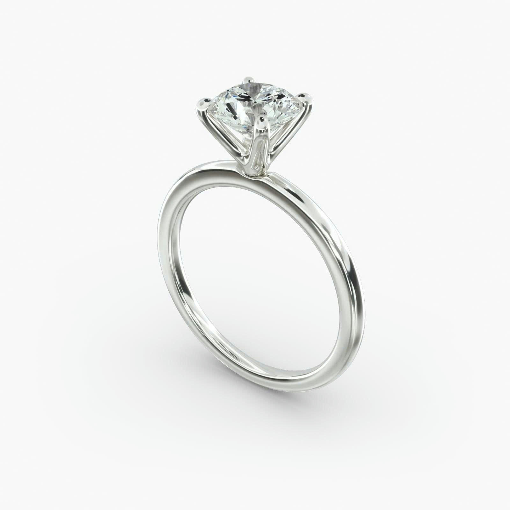
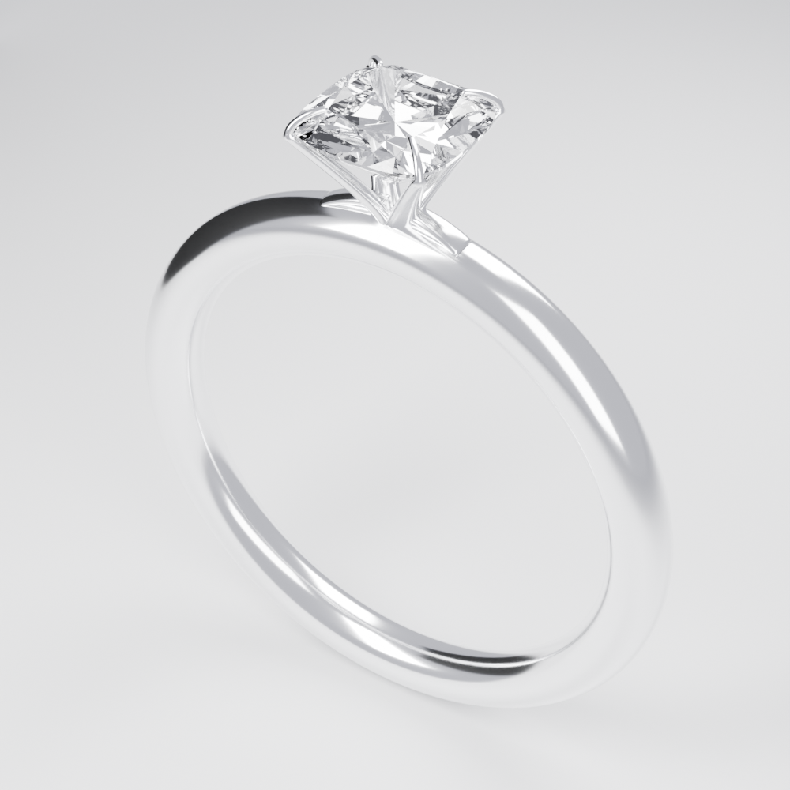

# 5. Recreate the example solitaire




*Left: reference. Right: the example built by this workflow.*

The target is a **white-gold, US 7, four-prong cushion solitaire** with an open V-head:

| Property | Value |
|---|---|
| Band | 21.7 mm outer diameter, 17.3 mm inner diameter (US 7), 2.2 mm comfort section |
| Stone | 5.5 × 5.5 × 3.1 mm rounded-square cushion, 67% table, 0.6 mm crown |
| Setting | Four sculpted V-arms with integrated claws, open pavilion, no donut rail |
| Metal | Polished white gold (`Gold_White`) |
| Render | 1000 × 1000, Cycles, denoise, neutral three-softbox studio |

There are two ways to do this exercise. Do **both** if you are learning: the replay proves the toolchain; the rebuild teaches the workflow.

---

## Path A — Replay the scripts (proves your setup)

This reproduces the model deterministically. It is the fastest way to find out whether your Blender/MCP installation is healthy.

### A1. Create a scratch project

```powershell
powershell -ExecutionPolicy Bypass -File .\tools\new-project.ps1 -Name replay-check
```

### A2. Copy the example scripts into it

```powershell
Copy-Item .\example-solitaire\scripts\*.py .\projects\replay-check\scripts\
```

### A3. Open the project

In Blender: **File → Open** → `D:\JewelryDesignTest\projects\replay-check\ring.blend`.

### A4. Run the scripts in order

Use Blender's **Scripting** workspace:

1. Click the **Scripting** tab at the top.
2. In the Text Editor, click **Open**.
3. Open `projects\replay-check\scripts\build_band.py`.
4. Click **Run Script** (the ▶ button).
5. Repeat for `build_gem.py`, `build_head.py`, `studio_render.py`, and finally `verify_scene.py`.

Alternatively, ask OpenCode:

> Read and run `projects/replay-check/scripts/build_band.py` in Blender, then `build_gem.py`, `build_head.py`, `studio_render.py`, and `verify_scene.py`, in that order. Save after each step.

Each script saves `ring.blend` and prints a line starting with `BUILT`, `STUDIO`, or `HERO`.

### A5. Expected results

The verification script prints:

```
PASS band: OD 21.7000 mm, ID 17.3000 mm; scene scale 1; band geometry checked
PASS gem: 5.5x5.5x3.1 mm; table 3.685 mm; crown .6 mm; 217 closed outward facets; clearance 1.05 mm
PASS head: four closed tapered V-arms, two compact shoulders, white metal; no rail/foot/ball tips
PASS claws: 4 integrated hooks, actual seat/tip mesh contact <= 0.0202 mm; low table-edge tips
PASS studio: Cycles, denoise, 1000x1000, valid clipping; vertical coverage 82.7%
```

The hero is at `projects\replay-check\renders\hero.png`. Open it and compare it with `example-solitaire\renders\hero.png`. Small differences in noise and highlight placement are normal; the geometry and composition should match.

If the replay fails, stop and fix the toolchain using [Troubleshooting](TROUBLESHOOTING.md) before trying Path B.

---

## Path B — Rebuild it with the AI (the real exercise)

This is the workflow you will use for your own designs. The AI writes new scripts; the example scripts are reference material, not a template to copy blindly.

### B1. Create a fresh project

```powershell
powershell -ExecutionPolicy Bypass -File .\tools\new-project.ps1 -Name my-solitaire
```

### B2. Open it in Blender

**File → Open** → `D:\JewelryDesignTest\projects\my-solitaire\ring.blend`.

### B3. Start OpenCode at the repository root

```powershell
cd D:\JewelryDesignTest
opencode
```

### B4. Attach the reference and paste the brief

Attach `example-solitaire/reference/target.jpg` to the chat (drag and drop it into the prompt), then paste:

> Open `projects/my-solitaire/ring.blend`. Build a white-gold, US 7, four-prong cushion solitaire that matches `example-solitaire/reference/target.jpg` as closely as possible. The stone is a 5.5 mm rounded-square cushion with a 67% table and a 0.6 mm crown. The head is four slender sculpted V-arms with integrated claws and an open pavilion, no donut rail or conical foot. The band is a 2.2 mm comfort band. Use `Gold_White` and `Gem_Center`, the `GEMS` and `METAL` collections, and save each script to `projects/my-solitaire/scripts/`. Inspect with `look` before rendering, then save a 1000×1000 Cycles hero to `projects/my-solitaire/renders/hero.png`. This is a visual model, not a manufacturing certification.

### B5. Make the AI work in stages

The example was built in this order: **stone → head → claws → studio**. Ask for the same order:

1. *Build the cushion stone first and show me top, side, and three-quarter close-ups.*
2. *Now build the four V-arms. Keep the pavilion open; do not add a rail or cone.*
3. *Add integrated claws that touch the stone and curve inward. Check actual mesh contact.*
4. *Configure the neutral studio and inspect the camera before rendering.*

### B6. Iterate one parameter at a time

Examples:

> The claws are too heavy. Reduce the claw width from 0.30 mm to 0.26 mm and re-run the contact checks.

> The shoulders read as separate stems. Move the arm roots 0.1 mm closer together and keep the seats fixed.

> The background is too dark. Raise the world strength from 0.80 to 1.00; keep the lights and camera fixed.

Do not say "make it nicer". Name the parameter and the target value. That is what makes the iteration reproducible.

### B7. Compare honestly

Put the reference and your render side by side. Check:

- The cushion outline reads as a softened square, not a circle or a beveled box.
- The table is flat and bright; the crown and pavilion facets are visible.
- The V-head is open; the stone does not sit on a solid pedestal.
- The claws are slender and integrated, not posts with balls.
- The band is round and continuous, with a believable reflection.

The example itself is not a pixel-perfect match. The remaining differences are listed below.

---

## Units: the one trap to understand

The template uses:

- Metric units.
- Length displayed in **millimetres**.
- **Scene scale 1.0** (1 Blender unit = 1 metre).

Design dimensions are written in millimetres and divided by 1000 for Blender coordinates. For example, a 21.7 mm band is `0.0217` Blender units.

A previous version of this workshop used scene scale `0.001` **and** divided millimetres by 1000, which applied the conversion twice. The model measured 21.7 mm but the scene reported a fraction of that. If your dimensions look 1000× too small or too large, check `scene.unit_settings.scale_length` first:

```python
import bpy
print(bpy.context.scene.unit_settings.scale_length)  # must be 1.0
```

---

## Known differences from the reference

The example is an honest visual match, not a replica:

- The shoulder junctions read as more separate than the reference's continuous flow.
- The claw tips are slightly more claw-like and slender.
- The studio highlights and background do not exactly duplicate the photograph.
- The pavilion and internal setting geometry cannot be fully known from one photograph.

These are recorded so you can improve them deliberately rather than chasing a perfect match.

---

## If you get stuck

- Replay fails → [Troubleshooting](TROUBLESHOOTING.md).
- The AI writes to the wrong folder → confirm OpenCode is running at `D:\JewelryDesignTest`, not inside `projects\my-solitaire`.
- The render is blank → check camera clipping, resolution, and the output path.
- The model is 1000× off → read the units section above.
- You want the exact example parameters → open `example-solitaire/README.md`.
