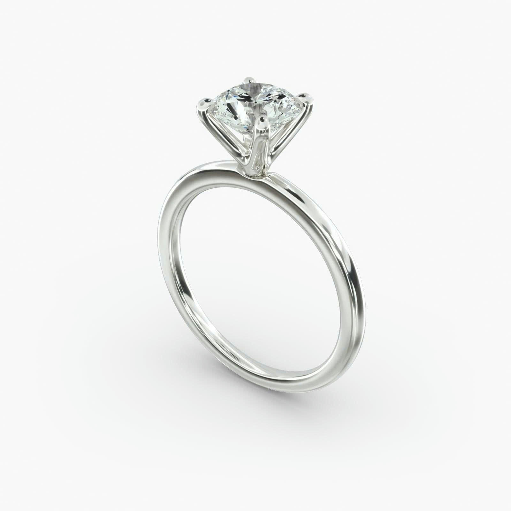
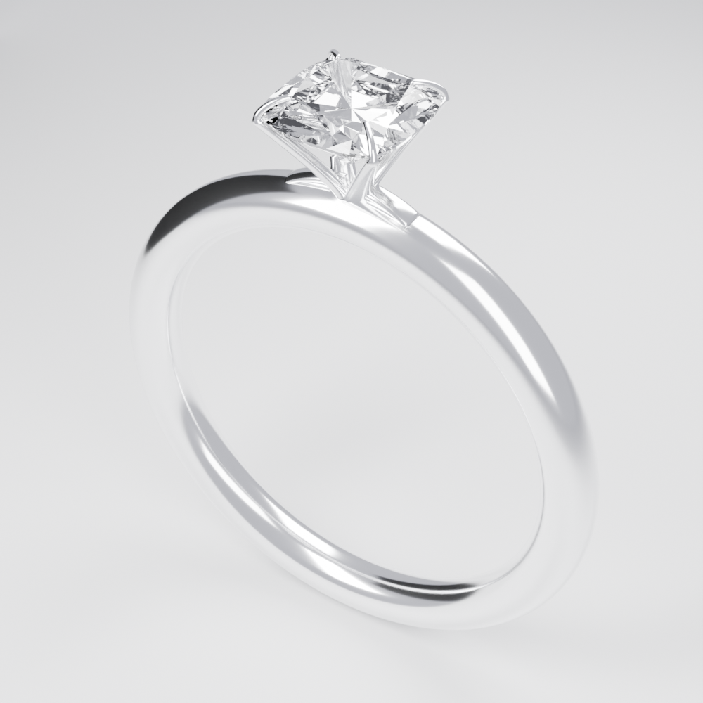

# Example solitaire




*Left: the reference photograph. Right: the render produced by this project.*

This is the single finished example for the workshop. It is a visual model, not a manufacturing or casting certification.

## Dimensions

| Property | Value |
|---|---|
| Band outer diameter | 21.7 mm |
| Band inner diameter | 17.3 mm (US 7) |
| Band section | 2.2 mm comfort profile |
| Center stone | 5.5 × 5.5 × 3.1 mm rounded-square cushion |
| Table | 67% linear width (3.685 mm) |
| Crown | 0.6 mm |
| Girdle | 0.10 mm |
| Pavilion | 2.4 mm |
| Girdle center | 25.2 mm above the band bottom (3.5 mm above the band top) |
| Culet clearance | 1.05 mm above the band top |
| Setting | Four sculpted V-arms with integrated claws; open pavilion |
| Metal | `Gold_White` |
| Stone material | `Gem_Center` (IOR 2.417, transmission 1.0) |
| Render | 1000 × 1000, Cycles, denoise, neutral three-softbox studio |

## Files

| File | Purpose |
|---|---|
| `ring.blend` | The final render-ready scene |
| `renders/hero.png` | The verified 1000×1000 render |
| `reference/target.jpg` | The reference photograph |
| `prompt.md` | The brief used to build the model |
| `scripts/build_band.py` | Builds the 21.7 mm comfort band and sets the scene datum |
| `scripts/build_gem.py` | Builds the closed 217-facet cushion brilliant |
| `scripts/build_head.py` | Builds the four V-arms, two shoulders, and integrated claws |
| `scripts/studio_render.py` | Configures the studio and renders `renders/hero.png` |
| `scripts/verify_scene.py` | Read-only checks for band, gem, head, claws, and studio |

## Rebuild order

Run these in a **copy** of `templates/ring-template.blend`, not in this folder:

1. `build_band.py` → creates `Band_WhiteGold`, sets `band_top_mm`, saves.
2. `build_gem.py` → creates `CenterStone_Cushion55`, saves.
3. `build_head.py` → creates `HeadArm_01`–`04` and `Shoulder_Left/Right`, saves.
4. `studio_render.py` → configures the studio and renders `renders/hero.png` (set `RENDER_NOW = False` to configure without rendering).
5. `verify_scene.py` → prints the five `PASS` groups.

The deterministic replay is described in [docs/05-recreate-example.md](../docs/05-recreate-example.md).

## Verify the checked-in blend

From the repository root:

```powershell
& "D:\JewelryStudio\Blender-4.5-LTS\blender.exe" --background --factory-startup `
  "example-solitaire\ring.blend" --python "example-solitaire\scripts\verify_scene.py"
```

Expected:

```
PASS band: OD 21.7000 mm, ID 17.3000 mm; scene scale 1; band geometry checked
PASS gem: 5.5x5.5x3.1 mm; table 3.685 mm; crown .6 mm; 217 closed outward facets; clearance 1.05 mm
PASS head: four closed tapered V-arms, two compact shoulders, white metal; no rail/foot/ball tips
PASS claws: 4 integrated hooks, actual seat/tip mesh contact <= 0.0202 mm; low table-edge tips
PASS studio: Cycles, denoise, 1000x1000, valid clipping; vertical coverage 82.7%
```

## Units

The scene uses `scale_length = 1.0`, metric units, and millimetres displayed. Design dimensions are in millimetres and divided by 1000 for Blender coordinates (21.7 mm → `0.0217`). Do not set `scale_length = 0.001` on top of that; doing so applies the conversion twice.

## Known differences from the reference

- The shoulder junctions read as more separate than the reference's continuous flow.
- The claw tips are slightly more claw-like and slender.
- Studio highlights and the background do not exactly duplicate the photograph.
- Hidden pavilion and setting geometry cannot be determined from one photograph.

These are recorded so you can improve them deliberately. Do not treat the example as a pixel-perfect replica or a production-ready casting.

## Using this folder

- **Read it, don't edit it.** Create your own project with `tools/new-project.ps1`.
- The scripts are reference material. A real rebuild should write its own scripts in `projects/<name>/scripts/`.
- If you want to experiment with the example, copy it to `projects/example-play/` first.
